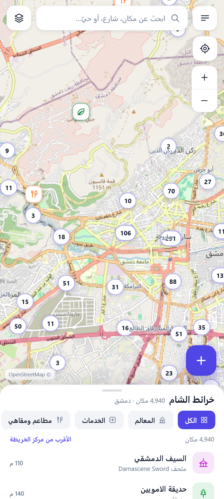
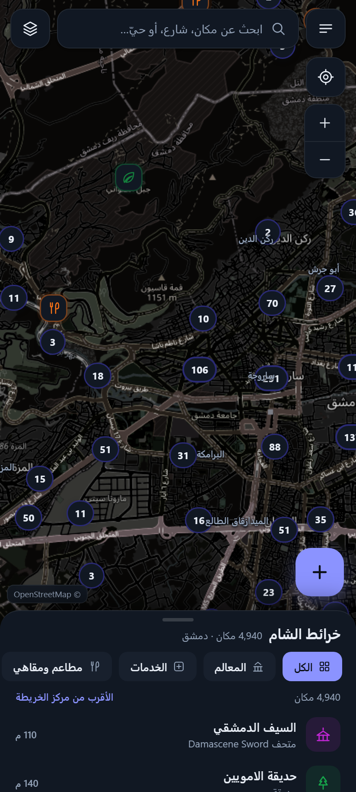
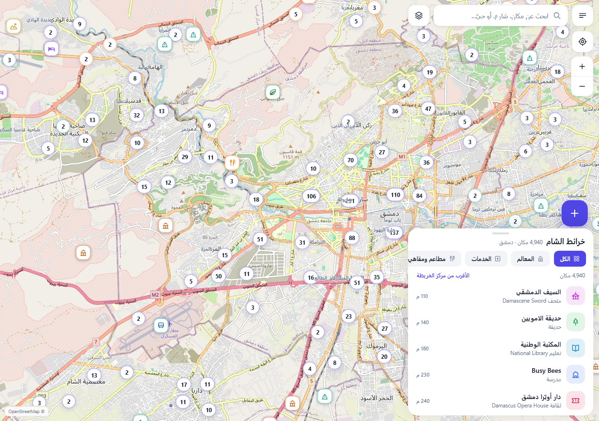

# 🌿 خرائط الشام — خريطة دمشق اللي بتضيف عليها

تطبيق خرائط للموبايل (PWA) لمحافظة دمشق: معالم وخدمات وأسواق وأحياء **+ أماكنك انت**،
بيشتغل من المتصفح، بينتثبّت عالشاشة الرئيسية متل أي تطبيق، و**بيشتغل بدون إنترنت**.

> الفكرة: غوغل ماب بيعطيك الأماكن اللي هو بيعرفها. هون بتقدر تضيف أي شي —
> مطعم ابن الحارة، كراج، مغارة، ملعب، نقطة تجمع — مع صورة وملاحظة وتقييم.

---

## شو الموجود

| الميزة | التفاصيل |
|---|---|
| 🗺️ خريطة تفاعلية | 4,940 مكان + 222 حي + شبكة شوارع (5,049 شارع) لمحافظة دمشق |
| ⚡ تفتح فوراً | شبكة الشوارع محلية وبتنرسم مباشرة، وبعدها بتنسلّ البلاطات الأونلاين بهدوء — ما في شاشة فاضية |
| 📌 أماكنك | أضف/عدّل/احذف: اسم، فئة، وصف، تقييم، صورة من الكاميرا |
| 📴 بدون إنترنت | كل البيانات + التطبيق محفوظين محلياً، وبلاطات الخريطة اللي بتشوفها بتنحفظ |
| 🔍 بحث عربي | أسماء، أحياء، شوارع، وفئات (مطعم، مشفى، جامع…) مع تطبيع الألف/الياء/التاء |
| ❤️ مفضلة و«زرتها» | ورتّب النتائج بالمسافة أو أبجدياً |
| 🧭 قياس وتوجيه | مسافة بين نقاط + طريق بالسيارة (OSRM) مع خط مباشر إذا ما في نت |
| 🏷️ طبقات | معالم / خدمات / مطاعم / أسواق / طبيعة + أسماء الأحياء + أماكنك |
| 🛰️ خرائط أساس | تلقائي، محلية (بدون إنترنت)، شوارع، وقمر صناعي (Esri ←بديل Sentinel-2) |
| 💾 بياناتك إلك | تصدير JSON كامل (مع الصور) + GeoJSON، واستيراد على أي جهاز |
| 📲 تثبيت | manifest + أيقونات + عمل بدون إنترنت |

---

## المظهر والهوية (v2)

- **واجهة فاتحة** بأسطح بيضاء وحدود ناعمة، ومواد رمادية هادئة — وثيم داكن اختياري كامل.
- **لون التمييز**: نيلي `#4F46E5` بدل الذهبي القديم.
- **خط عربي محلي**: IBM Plex Sans Arabic (SIL OFL) مستضاف داخل المشروع — بدون أي طلب لخدمات خارجية.
- **أيقونات SVG مرسومة خاصة بالتطبيق** (40+ أيقونة) بدل الإيموجي: لكل فئة شكل ولون ثابت.
- **أيقونة التطبيق**: دبوس أبيض على مربّع نيلي متدرّج — نظيفة وعصرية.

---

## صور من التطبيق

| فاتح | داكن |
|---|---|
|  |  |



بقية الصور في `shots/`: الترحيب، التفاصيل، إضافة مكان، الطبقات، والوضع المحلي بدون إنترنت.

---

## التشغيل

```bash
node tools/serve.js            # 127.0.0.1:4173
# أو: دبل كليك على start.bat  (أو أيقونة «خرائط الشام» عالـ Desktop)
```

### على الموبايل (نفس شبكة الواي فاي)

```bash
node tools/serve.js --host 0.0.0.0
```

بيطبع عنوان الشبكة، مثلاً `http://192.168.1.7:4173` — افتحه من متصفح الموبايل.

- **أندرويد (Chrome):** ⋮ ← «تثبيت التطبيق»
- **آيفون (Safari):** مشاركة ⬆️ ← «إضافة إلى الشاشة الرئيسية»

> لازم يفتح من سيرفر (http) — الملفات لحالها من `file://` ما بتشتغل بسبب الـ modules.

---

## الأداء (شو صار لتفتح أسرع)

1. **رسم محلي فوري**: 5,049 شارع بينرسمو بكانفاس واحد بمجرد تحميل الملف (بدون انتظار شبكة).
2. **بلاطات كسولة**: البلاطات تبدأ شفافة (opacity 0)، وأول ما توصل ~6 بلاطات بتنّسل، وإذا فشلت بترجع للخريطة المحلية برسالة واضحة.
3. **gzip على السيرفر**: `roads.json` من 1.44MB إلى 435KB على الشبكة.
4. **Service Worker**: يخزن التطبيق + بياناته + البلاطات (حد 600 بلاطة)، والأكواد بتتحدث network-first حتى ما تعلق نسخة قديمة.
5. **تقليل كثافة العلامات**: العنقدة بتتكيّف مع التقريب، والمواقع الثانوية بتظهر بس عند التقريب العالي.
6. **خطوط**: 8 ملفات woff2 مقسّمة بـ unicode-range، فبينزل بس اللي بيحتاجه (عربي ~40KB للوزن).
7. **إصلاح القمر الصناعي**: كان الـService Worker يفرض `mode:'cors'` على طلبات البلاطات، وبلاطات Esri ما بترسل CORS headers فكانت كلها تفشل — صار يمرّر الطلب متل ما هو (30/30 بلاطة تتحمّل).
8. **Service Worker مؤجَّل**: يسجّل بعد ما تخلص الصفحة بـ2.5 ثانية حتى ما ينافس تحميل بلاطات الخريطة أول مرة.

---

## بنية المشروع

```
index.html            واجهة التطبيق + SVG sprite للأيقونات
css/app.css           نظام التصميم (فاتح/داكن، شيت، بطاقات)
css/fonts.css         @font-face للخط المحلي
js/app.js             منطق الواجهة: القوائم، البحث، الإضافة، الأدوات
js/mapview.js         Leaflet + الطبقات + العناقيد + الطريق + القياس + البلاطات
js/store.js           التخزين المحلي (localStorage) والصور (IndexedDB)
js/search.js          محرّك البحث العربي
js/geo.js, js/config.js   أدوات ومكوّنات ثابتة (فئات، ألوان، خطوط)
sw.js                 Service Worker
manifest.webmanifest  بيانات التثبيت
data/roads.json       شبكة الشوارع (مضغوطة، إحداثيات صحيحة)
data/pois.json        الأماكن (أسماء عربية/إنكليزية + وسوم)
data/districts.json   أسماء الأحياء
icons/                أيقونات التطبيق (SVG + PNG + ICO)
vendor/               Leaflet + الخط
tools/serve.js        سيرفر محلي مع gzip
tools/build-data.js   بناء البيانات من مستخلصات Overpass
tools/ui-test.js      اختبار واجهة آلي (22 فحص)
tools/test-photo.js   اختبار الصور والتصدير (5 فحوص)
shots/                صور من الاختبارات
```

### تحديث/توسيع البيانات لمدينة تانية

1. نزّل من Overpass API مسارات الطرق والنقاط للمنطقة (نفس استعلامات `tools/build-data.js`).
2. حطّ الملفات الخام في `data/_raw_*.json`.
3. `node tools/build-data.js` → يبني `roads.json` و`pois.json` و`districts.json`.
4. عدّل `APP.bounds` و`APP.center` في `js/config.js`.

---

## الاختبارات

```bash
node tools/ui-test.js        # 22 فحص: السيناريو الكامل
node tools/test-photo.js     # 5 فحوص: الصور (ضغط/IndexedDB) والتصدير والاستيراد
```

الاختبار بيمشي سيناريو كامل (إقلاع، فئات، تفاصيل، مفضلة، طريق، إضافة مكان،
ضغط مطوّل، بحث، طبقات، وضع بدون إنترنت، قياس، ثيم، تصدير، Service Worker،
إعادة تحميل بدون إنترنت، رابط مشاركة) وبيصوّر كل خطوة بـ`shots/`.

آخر نتيجة: **27/27 ناجح**.

---

## البيانات والتراخيص

- بيانات الخريطة والأماكن: © [OpenStreetMap contributors](https://www.openstreetmap.org/copyright) — رخصة ODbL.
- بلاطات الشوارع: OpenStreetMap (وضع ليلي بتحويل لوني).
- الصور الجوية: © Esri (World Imagery) مع بديل Sentinel-2 cloudless © EOX.
- التوجيه: [OSRM](http://project-osrm.org/).
- الخط: IBM Plex Sans Arabic — SIL Open Font License 1.1.
- كل أماكنك وصورك محفوظة **على جهازك فقط**؛ ما في سيرفر ولا حساب ولا تتبّع.
